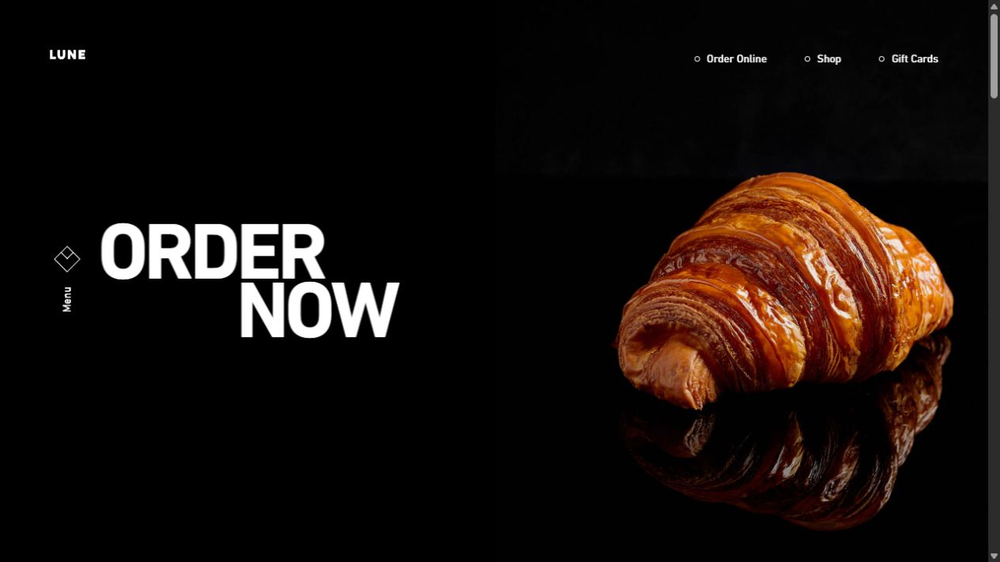
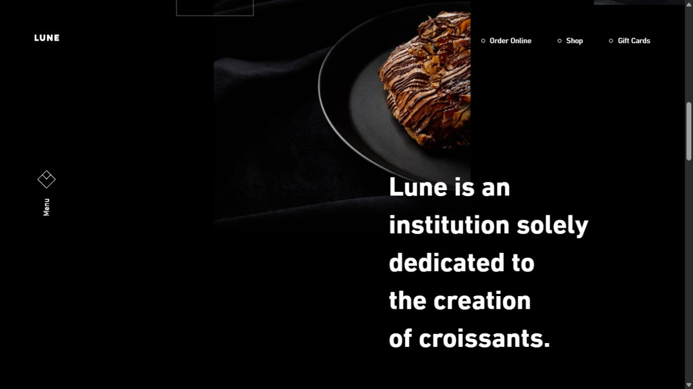
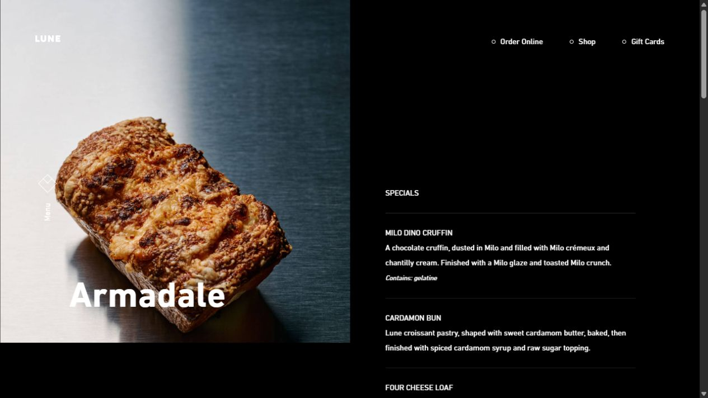
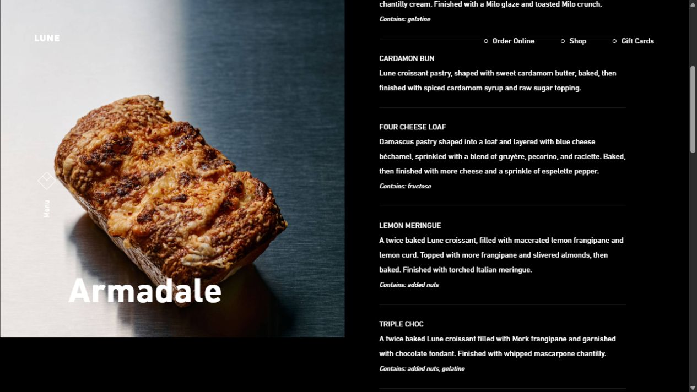

# Lune → три food-секции «Цеха»: предложение до реализации

Дата: 04.11.2026. Статус: только исследование и идея; реализация ожидает подтверждения пользователя.

## Наблюдения по живому референсу

1. Hero Lune — сильная иерархия: один крупный продукт на чёрном фоне, короткий заголовок со смещением второй строки, большой свободный промежуток. Состояние снято после загрузки. Фото содержит отражение. Источник: https://lunecroissanterie.com/ . Кадр: `01-lune-product.jpg`.
2. Секция после hero — сильная асимметрия: изображение и крупный текст стоят на разных осях, пересекаются по вертикали. Родители изображений `js-img-parallax` меняют translateY при нативной прокрутке. Проверены scrollY 432, 1152, 1584 и обратный ход; это пространственное движение относительно текста. Конкретные длительности и easing не измерялись. Источник тот же. Кадр: `02-lune-editorial.jpg`.
3. Страница Armadale — понятное разделение фотографии и длинного меню. На desktop фото занимает левую половину и остаётся у верхнего края, пока правый текст прокручивается: scrollY 0 → 468, верх фото остаётся 0. Это fixed-подача длинного меню, а не переключатель вкусов. Источник: https://lunecroissanterie.com/armadale-menu/ . Кадры: `03-lune-food-menu.jpg`, `04-lune-food-menu-scroll.jpg`.

## Применение к «Цеху»

Основа: три самостоятельные продуктовые сцены с общим ритмом. Существующие фотографии, тексты и выбор вкусов остаются основой. Взять у референса масштаб, асимметрию, пространство и спокойное относительное движение. Длительное закрепление фотографии из длинного меню Lune здесь не требуется.

- Каши: текст слева, крупная тарелка справа. Тарелка чуть ниже/выше оптического центра текста, чтобы композиция не выглядела как ровная строка каталога.
- Сырники: тарелка слева, текст справа. Увеличить именно видимый продукт примерно на 25–30%, затем отрегулировать по месту: квадратные PNG содержат большие прозрачные поля. Оригиналы не обрезать и не растягивать.
- Паста: фото справа, текст слева — завершить последовательность справа/слева/справа. Масштаб сопоставить с видимым диаметром тарелок предыдущих сцен.
- Заголовки слегка укрупнить в существующем шрифте, описание оставить коротким, выбор вкусов сделать хорошо читаемой группой с аккуратным индикатором выбранного пункта.

Режиссура: один вход при появлении секции — фото поднимается на 20–30 px и приходит от 0.97 к 1; заголовок раскрывается отдельно с отставанием около 80–100 ms; затем описание и переключатели. Вход ориентировочно 0.7–0.9 с. После входа допустимо малое scroll-смещение фото в пределах 16–24 px. Эти числа — предложение для «Цеха», не измеренные параметры Lune. Движение останавливается при остановке прокрутки; обратный ход плавный.

Переключение вкусов: короткое перекрытие двух фотографий примерно 200–240 ms, с сохранением центра тарелки и без схлопывания блока. Исходная защита от устаревших загрузок и decode-before-swap сохраняется. Подготовить производные WebP при необходимости: исходные фото сырников по 6.9–8.3 MB способны задерживать реакцию на выбор.

Мобильный вариант: заголовок/описание/вкусы → фото, свободные отступы короче; пространственное движение слабее. Reduced motion: готовая композиция без перемещения, переключения мгновенные или через короткую прозрачность. Клавиатурная доступность существующих кнопок должна сохраниться и будет проверена при реализации.

## Что видно сейчас и границы проверки

Пользователь предоставил текущий общий скриншот трёх секций. По нему и актуальному CSS видно: каша крупная, сырники ощутимо меньше, паста повторяет сторону фото сырников; вкусы значительно мельче заголовков. В исходниках у всех food-сцен один общий reveal; у смены сырников/пасты transform перекрывается более поздними правилами позиции. Это причина предложить раздельные слои для позиции, скролла и переключения.

Текущий локальный сайт в этом исследовании не запускался и не изменялся. Референс просмотрен на desktop 1280×720; мобильный Lune, полный цикл входной анимации по кадрам, WCAG и экранный диктор не проверялись. Нельзя считать это полной проверкой доступности. Сохранены только исследовательские файлы, продуктовый код не редактировался.

## Кадры

